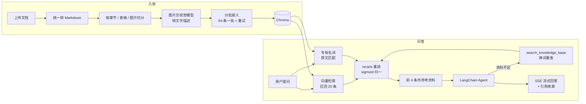

# EnterpriseQABase 企业内部知识库问答系统

基于 Flask + Vue 3 的企业知识库 RAG 问答系统。管理员上传制度、手册等文档，系统自动解析、切分并写入向量库；员工通过对话提问，系统检索相关片段，由本地大模型生成带引用来源的回答。所有模型均通过 Ollama 在本地运行，数据不出内网。

核心目标不是「接一个大模型」，而是**在本地弱模型上把回答的可信度做出来**：先检索再生成、混合召回、重排过滤、没资料就说没找到。过程中踩到的 16 类真实问题记录在 [docs/面试案例.md](docs/面试案例.md)。

## 处理流程



入库走后台单线程队列，前端轮询进度；问答走 SSE 流式输出。两条链路互不阻塞。

## 功能

- 文档入库：支持 txt / md / pdf / docx / csv，统一转成 Markdown 后按章节、表格、图片分别切分
- 图片识别：用视觉模型把文档中的图片转成文字描述，图片内容也能被检索到
- 混合检索：向量检索 + 专有名词关键词检索召回，bge-reranker 重排序后过滤低分片段
- RAG Agent：基于 LangChain 1.x `create_agent`，先预检索再回答，资料不足时模型可调用检索工具换关键词重查
- 流式问答：SSE 流式输出，支持多会话、历史记录、引用来源展示
- 后台任务：文档解析与向量化在后台线程执行，前端实时显示处理进度
- 后台管理：数据概览（ECharts 图表）、用户管理、知识库管理、文档管理
- 权限控制：JWT 认证，区分管理员（admin）和普通用户（user）

## 技术栈

| 层 | 技术 |
| --- | --- |
| 前端 | Vue 3、TypeScript、Vite、Element Plus、Pinia、Vue Router、ECharts、marked |
| 后端 | Python 3.12、Flask、Flask-SQLAlchemy、PyJWT |
| 数据库 | MySQL（业务数据）、Chroma（向量数据） |
| AI | LangChain 1.x、Ollama（qwen3:8b / qwen3-embedding:4b / qwen3-vl:8b-instruct）、fastembed（bge-reranker-v2-m3） |
| 文档解析 | pymupdf4llm、python-docx、firecrawl-anydoc |

## 目录结构

```
EnterpriseQABase/
├── client/                 # 前端（Vue 3 + Vite）
│   └── src/
│       ├── api/            # 接口封装（axios）
│       ├── components/     # 消息、图表、用户菜单等组件
│       ├── layouts/        # 后台布局
│       ├── router/         # 路由与登录守卫
│       ├── stores/         # Pinia 状态
│       ├── utils/sse.ts    # SSE 流式解析
│       └── views/          # 登录、问答、后台管理页面
├── server/                 # 后端（Flask）
│   ├── api/                # 接口层，每个模块一个蓝图
│   ├── models/             # SQLAlchemy 模型
│   ├── services/           # 业务逻辑：Agent、文档处理、向量库、rerank、识图、统计
│   ├── utils/              # 文本切分、权限装饰器、统一响应
│   ├── scripts/            # 相似度阈值测定脚本
│   ├── sql/init.sql        # 数据库初始化脚本（含测试数据）
│   ├── data/samples/       # 示例文档
│   ├── config.py           # 配置（读取 .env）
│   └── app.py              # 应用入口
└── docs/                   # 面试案例：16 个真实问题的定位与修复记录
```

## 环境要求

- Python 3.12+，[uv](https://docs.astral.sh/uv/)
- Node.js 20+
- MySQL 8+
- [Ollama](https://ollama.com/)，建议有 GPU（识图和问答模型对显存要求较高）

## 快速开始

### 1. 准备模型

```bash
ollama pull qwen3:8b
ollama pull qwen3-embedding:4b
ollama pull qwen3-vl:8b-instruct   # 可选，不需要识图时可不拉取，并把 VISION_MODEL 置空
```

rerank 模型由 fastembed 首次使用时自动从 Hugging Face 下载到 `server/models_cache/`。

### 2. 初始化数据库

```bash
mysql -uroot -p < server/sql/init.sql
```

脚本会创建 `db_enterprise_qa` 库和测试数据。注意它会先删除同名表，重复执行会清空已有数据。

### 3. 启动后端

把 `server/.env.example` 复制为 `server/.env` 并按需修改（配置项见下文），然后：

```bash
cd server
uv sync
uv run python app.py
```

服务监听 `http://127.0.0.1:5000`，可访问 `/api/health` 检查是否启动成功。

### 4. 启动前端

```bash
cd client
npm install
npm run dev
```

访问 `http://localhost:5173`。开发环境下 Vite 会把 `/api` 请求代理到后端。

### 5. 向量化示例文档

`init.sql` 预置的 4 份示例文档状态为“排队中”，尚未写入向量库。用管理员账号登录后，进入“文档管理”，对这些文档点击“重建索引”即可。

## 测试账号

所有账号密码均为 `123456`：

| 账号 | 角色 | 说明 |
| --- | --- | --- |
| admin | 管理员 | 可进入后台管理 |
| zhangsan | 普通用户 | |
| lisi | 普通用户 | |
| wangwu | 普通用户 | 已禁用，无法登录 |

部署到正式环境前请修改密码和 `JWT_SECRET`。

## 配置说明

配置写在 `server/.env`，未配置的项使用 `server/config.py` 中的默认值。

| 配置项 | 默认值 | 说明 |
| --- | --- | --- |
| DB_HOST / DB_PORT | 127.0.0.1 / 3306 | MySQL 地址 |
| DB_NAME | db_enterprise_qa | 数据库名 |
| DB_USER / DB_PASSWORD | root / 空 | 数据库账号 |
| JWT_SECRET | dev-secret | JWT 签名密钥，务必改成随机字符串 |
| JWT_EXPIRE_HOURS | 24 | token 有效期（小时） |
| OLLAMA_BASE_URL | http://127.0.0.1:11434 | Ollama 地址 |
| LLM_MODEL | qwen3:8b | 问答模型 |
| EMBEDDING_MODEL | qwen3-embedding:4b | 嵌入模型 |
| VISION_MODEL | qwen3-vl:8b-instruct | 识图模型，留空则不识别图片 |
| CHROMA_DIR | chroma_db | 向量库目录（相对 server/） |
| CHROMA_COLLECTION | enterprise_kb | 向量库集合名 |
| CHUNK_SIZE / CHUNK_OVERLAP | 500 / 50 | 切分长度和重叠长度 |
| TOP_K | 4 | 最终交给大模型的片段数 |
| SCORE_THRESHOLD | 0.45 | 向量相似度阈值，仅在未启用 rerank 时生效 |
| RERANK_MODEL | BAAI/bge-reranker-v2-m3-int8 | rerank 模型，留空则不启用 |
| RERANK_CANDIDATES | 20 | 向量检索召回的候选数 |
| RERANK_THRESHOLD | 0.3 | rerank 分数阈值（0~1） |
| KEYWORD_MAX_HITS | 3 | 专有名词命中片段数不超过该值时强制保留这些片段 |
| MODEL_CACHE_DIR | models_cache | rerank 模型缓存目录 |
| IMAGE_MIN_SIZE | 100 | 宽或高小于该像素的图片视为装饰，不识别 |

阈值和所用模型强相关，更换 embedding 或 rerank 模型后，建议用脚本重新测定：

```bash
cd server
uv run python scripts/eval_threshold.py --kb-id 1            # 测向量相似度，对应 SCORE_THRESHOLD
uv run python scripts/eval_threshold.py --kb-id 1 --rerank   # 测 rerank 分数，对应 RERANK_THRESHOLD
```

## 问答流程

1. 用户提问后，先用原问题做向量检索，同时用问题中的专有名词做关键词检索
2. 候选片段交给 rerank 模型重新打分，过滤低于阈值的片段，取前 TOP_K 条
3. 片段作为参考资料随问题交给 Agent；资料不够时，模型可调用 `search_knowledge_base` 工具换关键词再查
4. 回答通过 SSE 流式返回前端，问题、答案和引用来源保存到 MySQL

## 检索效果与评测

| 阶段 | 相关问题分数 | 无关问题分数 | 两组间隔 |
| --- | --- | --- | --- |
| 仅向量检索 | 0.46 ~ 0.75 | 0.21 ~ 0.41 | 0.05 |
| 加 rerank 后 | 大部分 0.94 以上 | 大部分低于 0.03 | 0.24 |

- **阈值标定**：`scripts/eval_threshold.py` 用两组问题（库里有答案 / 没有答案）分别统计检索最高分，阈值取在两组之间。当前 `SCORE_THRESHOLD=0.45`（相关问题最低 0.463，无关问题最高 0.412）。阈值和 embedding 模型强相关，所以做成配置项而不是写死在代码里。
- **端到端**：42 道题的问答测试，逐题检查来源里是否包含答案所在块、没有来源时是否编造出处，41 道一次通过。
- **尚未做**：Recall@k、MRR 这类系统指标，以及用 LLM 给回答质量打分；评测集只有几十题，统计意义有限。

调参时容易踩的坑：评测集必须和当前入库数据对应。第一次测出的两组分数是重叠的，排查后发现「相关问题」里有 5 个的答案文档根本还没入库，它们实际上是无关问题。

## 关键设计取舍

| 环节 | 选择 | 代价 |
| --- | --- | --- |
| 模型部署 | 全部本地 Ollama，数据不出内网 | 8B 模型能力弱：会跳过检索、会编造出处，必须在工程上补 |
| 召回策略 | 向量检索 + 专有名词原文匹配 | Chroma 正则是全量扫描，文档量大了要换 BM25 |
| 候选精排 | bge-reranker 交叉编码重排 | CPU 上 20 个候选约 1.9 秒 |
| 是否检索 | 由代码预检索，不让模型决定 | 每轮固定多一次检索开销 |
| 后台任务 | Flask 进程内线程池，单线程串行 | 重启丢任务（启动时标失败兜底），多进程必须换 Celery |

三个与「可信度」直接相关的实现细节：

1. **预检索**：原本靠 Agent 自己决定要不要调检索工具，实测带 6 条历史时 4 次里有 1 次没调用，回答变成模型自己编。改成每轮先用原问题检索一次，结果作为参考资料一起交给模型；工具保留，资料不够时可以换词重查。
2. **没有资料时明确告知**：不检索到内容时，提示词明确告诉模型「知识库中没有相关内容」，而不是只把问题丢过去。
3. **未找到就清空来源**：回答里出现兜底话术时，前端和数据库里的来源都置空，避免「说没找到却挂着来源」。

## 接口概览

所有接口前缀为 `/api`，除登录外都需要请求头 `Authorization: Bearer <token>`。

| 模块 | 接口 | 权限 |
| --- | --- | --- |
| 认证 | `POST /auth/login`、`GET /auth/profile`、`PUT /auth/password` | 登录用户 |
| 问答 | `GET/POST /chat/sessions`、`DELETE /chat/sessions/<id>`、`GET /chat/sessions/<id>/messages`、`POST /chat/ask`（SSE） | 登录用户 |
| 知识库 | `GET /knowledge` | 登录用户 |
| 知识库 | `POST /knowledge`、`PUT/DELETE /knowledge/<id>` | 管理员 |
| 文档 | `GET /documents`、`POST /documents/upload`、`POST /documents/<id>/reindex`、`DELETE /documents/<id>` | 管理员 |
| 用户 | `GET/POST /users`、`PUT/DELETE /users/<id>`、`PUT /users/<id>/reset-password` | 管理员 |
| 统计 | `GET /stats/overview`、`/stats/trend`、`/stats/doc-distribution`、`/stats/active-users` | 管理员 |

## 已知局限

- 关键词检索只要原文含问题中的专有名词就会保留该片段，同名但不相关时可能带出一条无关来源
- 代码块在解析时被压成一行，字段名和注释还在，按关键词能搜到，但格式丢失
- 前端还不能显示原图：chunk 里已存图片路径，缺一个带权限校验的图片访问接口
- 视觉模型识别约每张 2 秒，图片多的文档处理时间会明显变长
- 单个上传文件不超过 20MB
- 文档处理队列在进程内，同一时间只处理一个文档，服务重启时未完成的文档会被标记为失败，需要重新点击「重建索引」
- 只适合单进程部署（`app.run`）；用 gunicorn 等多进程方式部署时，必须把后台任务换成 Celery / RQ

## 安全提醒

本项目带演示性质，正式使用前至少要先改这三处：

- 密码使用**不加盐的 MD5** 存储（`server/services/auth_service.py`），建议换成 bcrypt / argon2
- `/api/*` 跨域对所有来源开放，需要收紧 CORS
- 所有测试账号密码均为 `123456`，`JWT_SECRET` 默认是 `dev-secret`，部署前必须修改
